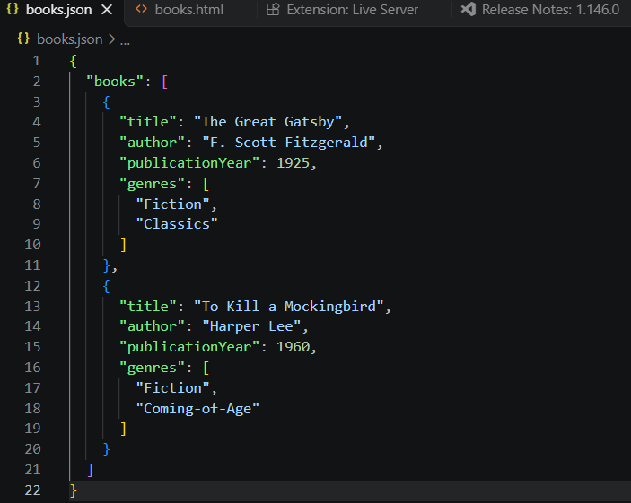
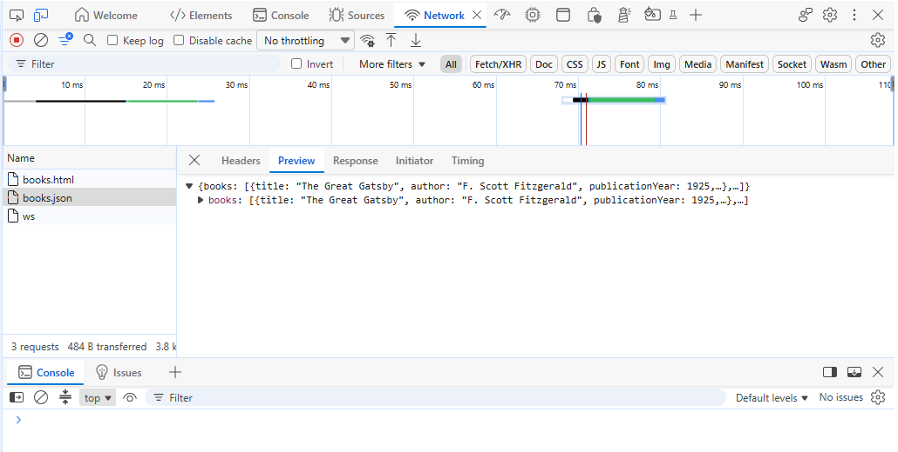
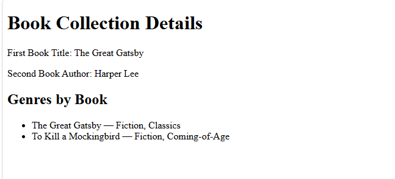
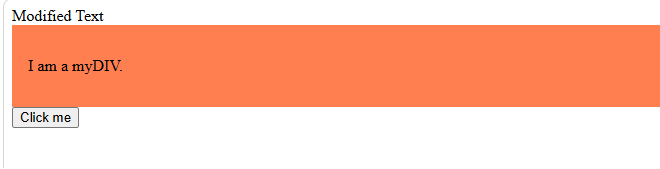

# Lab #4b: Client-Side Scripting (JSON and jQuery)

- **Name:** Ainatul Balqis binti Ahmad Bukhari
- **Student Id:** AI250156
- **Course:** BIC21203 Web Development  

## Question 1: Create and Structure JSON Data

Screenshot of the complete JSON file and confirmation that it parses successfully.

  
*Figure 1: Screenshot of the complete JSON file*

The JSON structure in `books.json` is valid and successfully parsed without any syntax or parsing errors when loaded via Live Server.

  
*Figure 2: Confirmation that books.json parses successfully.*

## Question 2 — Retrieve and Display JSON Data

  
*Figure 3: JSON data output*

## Question 3 — Compare Native JavaScript and jQuery

  
*Figure 4: Output of jquery-dom.html*

### 1) State one advantage of native JavaScript and one situation where an existing project may still use jQuery.
The advantage of native JavaScript is that it does not require external library downloads, resulting in lighter page loads and direct browser support. The situation where an existing project may still use jQuery is when maintaining legacy codebases or third-party plugins that already depend on jQuery without risking regressions during a major rewrite.

### 2) Explanations:
- **Question 1 (`books.json`):** `books.json` stores structured book data in valid JSON format (objects, arrays, and key-value pairs) and loads without syntax or parsing errors when served via Live Server.
- **Question 2 (`books.html`):** `books.html` fetches `books.json` asynchronously using the Fetch API (`async/await`) over a local server and dynamically displays the first book's title, second book's author, and each book's genres in the browser.
- **Question 3 (`jquery-dom.html`):** `jquery-dom.html` uses jQuery to update text, apply the `.myStyle` class, and handle button clicks cleanly. Native JavaScript has the advantage of no external library overhead and direct browser support, while existing projects may still use jQuery to maintain legacy code or existing jQuery plugins without risking disruptions from a full rewrite.